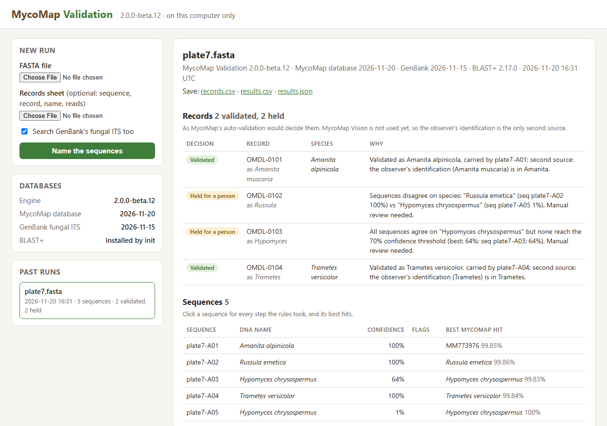
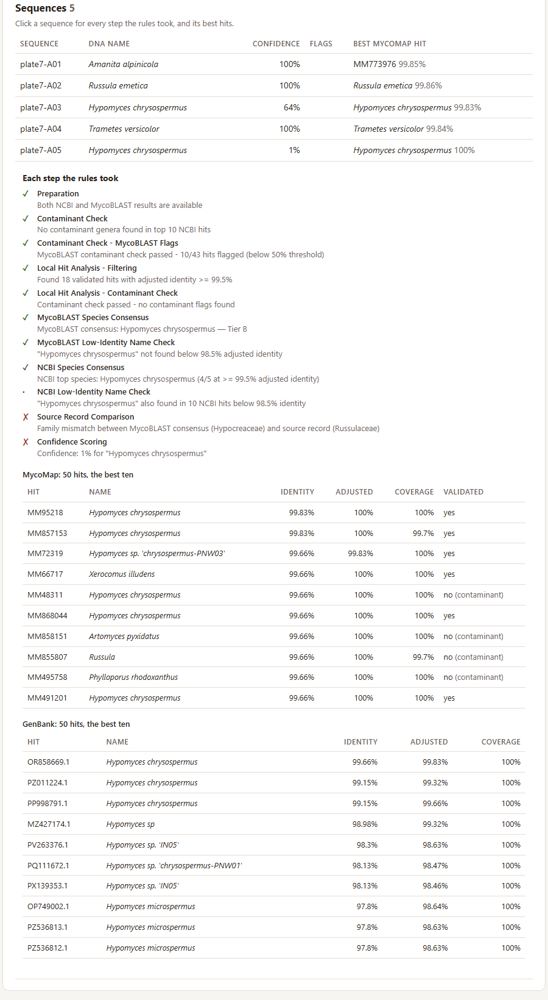

# MycoMap Validation

MycoMap Validation names fungal specimens from their DNA barcodes the way
[MycoMap](https://mycomap.org) does.

**The easiest way to use it is [MycoBLAST.org](https://mycoblast.org).** Run a
BLAST search there: when it finishes, MycoMap Validation runs on the results
and the page shows its answer at the top (the DNA name, how sure it is, and
the checks the rules made), with an Analysis tab that shows every step. There
is nothing to install.

To name many sequences at once, decide whole records as MycoMap's
auto-validation would, or keep everything on your own computer, use this
repository. It has two parts:

| | What it is | Who needs it |
|---|---|---|
| **The tool** | `mycomap-validation`, a program you install and run. Give it a FASTA file of fungal ITS sequences and, if you like, a sheet saying which record each one belongs to and what it was identified as. It sets up BLAST+ (NCBI's standard DNA search program) and MycoMap's and GenBank's reference databases on your computer, searches your sequences against them, applies the rules, and gives you the answers as spreadsheet files or in your browser. | Anyone naming their own sequences. Start at [Naming your own sequences](#naming-your-own-sequences). |
| **The rules** | MycoMap's validation rules, written as code anyone can read, run and check (folder `src/`). Given a sequence's search results and its record's details, they decide what the specimen is, how sure that is, what might be wrong (a contaminant, a read that is not the target fungus, two species too close to tell apart) and whether the record can be validated, and they show every step. mycomap.org runs this same code for every record it validates. The rules never search, download or connect to anything themselves, so the same input always gives the same decision. | Anyone who wants to read or check the rules, and developers building on them. |

Most people who use this repository need only the tool. The rules are all
here to read:
[What it decides](#what-it-decides) says what they do in plain words, and the
[worked examples](#worked-examples) run them on small, ready-made inputs.

**Version 2.0.0.** It holds MycoMap's auto-validation rules v1.4, the
same code mycomap.org runs today. The tool's commands: `init` sets up MycoMap's and GenBank's
databases and BLAST+ in one step, `run` names the sequences in a FASTA file on
your own computer and decides each record as auto-validation would, and `ui`
does the same in your browser. With your own keys it can also ask MycoMap
Vision about each record, ask NCBI live about sequences the weekly GenBank
database does not answer, and send your sequences to MycoMap (`contribute`);
`export` writes Darwin Core, GenBank submission and iNaturalist files. See
[CHANGELOG.md](CHANGELOG.md) for what each release holds.

## Quick start

On your own computer, name your fungal ITS sequences in four steps. Every step is explained in
full further down, in [Naming your own sequences](#naming-your-own-sequences).

1. **Install the tool** with one line. On Windows, in PowerShell:
   ```powershell
   irm https://github.com/BiodiverseLabs/mycomap-validation/releases/download/v2.0.0/install.ps1 | iex
   ```
   On a Mac or Linux, in Terminal:
   ```bash
   curl -fsSL https://github.com/BiodiverseLabs/mycomap-validation/releases/download/v2.0.0/install.sh | sh
   ```
2. **Set it up, once.** The installer then runs `mycomap-validation init`,
   which downloads BLAST+ and MycoMap's and GenBank's reference databases. It
   says how much it will download and asks before it starts.
3. **Name your sequences:**
   ```bash
   mycomap-validation run my-sequences.fasta
   ```
   Add `--records my-records.csv`, a sheet saying which record each sequence
   belongs to and what it was identified as, and it also decides each record
   as MycoMap's auto-validation would.
4. **Read the results** in the folder it makes next to your FASTA file
   (`my-sequences_mycomap-validation`): `results.csv`, one row per sequence,
   and `records.csv`, one row per record, open in any spreadsheet. Or run
   `mycomap-validation ui` to do all of this in your browser.

Nothing of yours leaves your computer unless you ask it to (see
[Questions](#questions): "Is my data sent anywhere?").

## Contents

- [Quick start](#quick-start)
- [Who this is for](#who-this-is-for)
- [What it decides](#what-it-decides)
- [Getting started](#getting-started)
- [Worked examples](#worked-examples)
- [Trying it on your own specimen](#trying-it-on-your-own-specimen)
- [Naming your own sequences](#naming-your-own-sequences)
- [The numbers behind the rules](#the-numbers-behind-the-rules)
- [Words used here](#words-used-here)
- [Questions](#questions)
- [For developers](#for-developers)
- [Releases](#releases)
- [Contributing](#contributing)
- [Licence](#licence)

## Who this is for

- **Mycologists and collectors** who sequence their own specimens and want to
  see how a DNA identification is reached, or check one against the rules
  MycoMap applies.
- **Herbaria and fungaria** deciding whether a sequenced specimen's name is
  supported by its barcode.
- **Reviewers and readers** of MycoMap's data who want to know exactly why a
  record was validated, held for a person, or rejected.
- **Developers** building tools on the same rules.

The worked examples below need no programming: each is a small text file you
can change, and one command (`pnpm example`, in a copy of this repository)
shows what the rules decide about it.

## What it decides

For each sequence of a specimen, in order:

1. **Is it a contaminant?** A read whose best matches are moulds, yeasts or
   other common lab contaminants (*Cladosporium*, *Aspergillus*, *Candida* and
   others), or a family that has nothing to do with the specimen, is flagged
   and not used to name it.
2. **What do MycoMap's own DNA-validated sequences say?** This is where a
   specimen's name comes from. Hits in MycoMap's reference sequences
   ("MycoBLAST") count only when the reference is itself validated and close
   enough (99.5% adjusted identity), and two or more must agree on one
   species. If none is clear, a second pass at 99% accepts agreement among
   whichever validated MycoMap hits reach 99%, even a single one, with the
   confidence halved.
3. **What does GenBank say?** NCBI's hits are checked alongside: they catch
   contaminants, their top species is reported, and agreeing or disagreeing
   with MycoMap's name raises or lowers the confidence score. On their own
   they do not name a specimen (see [Questions](#questions)).
4. **Is one species clear?** If it is, that is the DNA name, with a confidence
   score. If no species is clear at 99.5%, it tries again at 99%. If it still
   cannot choose, it says a barcode gap check is needed: the species are too
   close for this region to tell apart.
5. **Does it fit the record?** The DNA name's family is compared with the
   family of the name on the record.

Then, for the record as a whole: the reads of one specimen are weighed
together (a stray read from another organism is set aside), and the record is
**validated** as one species, **held for a person** to look at, or left
**waiting** for evidence still to come. Where an identification from the photos
is available ([MycoMap Vision](#words-used-here)), it can back the DNA or hold
a record whose DNA points somewhere else.

### What it does not do

- The rules do not run BLAST, download anything or look anything up.
  Everything they need, the BLAST results included, is handed to them, which
  is why every decision can be repeated exactly. The tool does those parts on
  your computer: `init` downloads BLAST+ and the databases (or uses a BLAST+
  you already have), and `run` searches them
  ([Naming your own sequences](#naming-your-own-sequences)).
- It does not look at photos. An identification from the photos is one more
  input.
- It does not change any record. It answers; mycomap.org (or you) decides what
  to do with the answer.
- It is built for the fungal ITS barcode. The thresholds are set for ITS and
  have not been tested on other regions.

## Getting started

To name your own sequences you need none of this: install the tool with one
line ([Installing it: one line](#installing-it-one-line)).
The steps here are for the worked examples and for changing the rules.

You need a computer with Windows, macOS or Linux, and about ten minutes.

1. **Install Node.js** version 22 or later from
   [nodejs.org](https://nodejs.org).
2. **Turn on pnpm**, the package manager this project uses. Open a terminal
   (on Windows: PowerShell; on macOS: Terminal) and run:
   ```bash
   corepack enable
   ```
   If that says `corepack` is not found (newer Node.js releases leave it
   out), run `npm install -g corepack` first.
3. **Get this repository**: either the green **Code → Download ZIP** button on
   GitHub (then unzip it), or
   ```bash
   git clone https://github.com/BiodiverseLabs/mycomap-validation.git
   ```
4. **Go into its folder and install** what it needs (a minute or two the first
   time):
   ```bash
   cd mycomap-validation
   pnpm install
   ```
   (From the ZIP, the folder is `mycomap-validation-main`.)
5. **Run an example**:
   ```bash
   pnpm example name-a-specimen
   ```
   `pnpm example` on its own lists every example and the inputs that come with
   it.

## Worked examples

Each example reads an input file from [`examples/inputs/`](examples/inputs)
and prints what the rules decide. The outputs below are exactly what the
commands print: they are produced from the code when this repository is
published, and a test checks they still match.

### 1. A clean identification

A *Russula emetica* collection whose ITS read matches six DNA-validated
MycoMap sequences (100% adjusted identity) and eight GenBank records (100%
identity, which is all NCBI shows). The input,
[`examples/inputs/russula-emetica.json`](examples/inputs/russula-emetica.json):

```json
{
  "about": "A Russula emetica specimen whose read matches six DNA-validated MycoMap sequences (plain and adjusted identity, as mycomap.org's BLAST page shows them) and eight GenBank records at 100% (NCBI shows plain identity only).",
  "recordName": "Russula emetica",
  "readCount": 40,
  "mycomapHits": [
    { "name": "Russula emetica", "identity": 99.67, "adjustedIdentity": 100 },
    { "name": "Russula emetica", "identity": 99.67, "adjustedIdentity": 100 },
    { "name": "Russula emetica", "identity": 99.67, "adjustedIdentity": 100 },
    { "name": "Russula emetica", "identity": 99.67, "adjustedIdentity": 100 },
    { "name": "Russula emetica", "identity": 99.67, "adjustedIdentity": 100 },
    { "name": "Russula emetica", "identity": 99.67, "adjustedIdentity": 100 }
  ],
  "ncbiHits": [
    { "name": "Russula emetica", "identity": 100 },
    { "name": "Russula emetica", "identity": 100 },
    { "name": "Russula emetica", "identity": 100 },
    { "name": "Russula emetica", "identity": 100 },
    { "name": "Russula emetica", "identity": 100 },
    { "name": "Russula emetica", "identity": 100 },
    { "name": "Russula emetica", "identity": 100 },
    { "name": "Russula emetica", "identity": 100 }
  ],
  "families": { "Russula": "Russulaceae" }
}
```

```bash
pnpm example name-a-specimen russula-emetica
```

```text
A Russula emetica specimen whose read matches six DNA-validated MycoMap sequences (plain and adjusted identity, as mycomap.org's BLAST page shows them) and eight GenBank records at 100% (NCBI shows plain identity only).

Record name:   Russula emetica
Read count:    40
Hits:          6 MycoMap, 8 NCBI
Identity used: MycoMap 6 adjusted; NCBI 8 plain (no adjusted identity given)

DNA name:      Russula emetica
Confidence:    100%
Flags:         none

Steps:
  ✓ Preparation: Both NCBI and MycoBLAST results are available
  ✓ Contaminant Check: No contaminant genera found in top 10 NCBI hits
  ✓ Contaminant Check - MycoBLAST Flags: MycoBLAST contaminant check passed - no contaminant flags found among 6 hits at >= 98.5% identity
  ✓ Local Hit Analysis - Filtering: Found 6 validated hits with adjusted identity >= 99.5%
  ✓ Local Hit Analysis - Contaminant Check: Contaminant check passed - no contaminant flags found
  ✓ MycoBLAST Species Consensus: MycoBLAST consensus: Russula emetica — Tier A
  ✓ MycoBLAST Low-Identity Name Check: "Russula emetica" not found below 98.5% adjusted identity
  ✓ NCBI Species Consensus: NCBI top species: Russula emetica (8/8 at >= 99.5% raw identity)
  ✓ Source Record Comparison: Families match: Russulaceae
  ✓ Confidence Scoring: Confidence: 100% for "Russula emetica"
```

Every step passed: no contaminant genera among the best GenBank hits, six
validated MycoMap hits at 99.5% or more, both sources agree on the species, and
its family matches the family of the name on the record.

### 2. A contaminant

The same record name, but the read is a mould: every GenBank hit is
*Cladosporium cladosporioides* and nothing in MycoMap matches
([`mould-on-a-russula.json`](examples/inputs/mould-on-a-russula.json)).

```bash
pnpm example name-a-specimen mould-on-a-russula
```

```text
A specimen recorded as Russula emetica whose read is a mould: every GenBank hit is Cladosporium cladosporioides, and nothing in MycoMap matches.

Record name:   Russula emetica
Read count:    40
Hits:          0 MycoMap, 6 NCBI
Identity used: NCBI 6 plain (no adjusted identity given)

DNA name:      (none)
Confidence:    (none)
Flags:         contaminant
Likely is:     Cladosporium cladosporioides

Steps:
  ✓ Preparation: Both NCBI and MycoBLAST results are available
  ✗ Contaminant Check: Contaminant genera detected in NCBI results
  ✗ Contaminant Check - Family Comparison: Family mismatch - sequence flagged as contaminant
```

The read is flagged as a contaminant and gives the record no name. The rules
still say what it most likely is, so the person looking at the record can see
it was a mould and not a different *Russula*.

### 3. Two species too close to tell apart

An *Amanita* whose MycoMap and GenBank hits both split evenly between
*Amanita muscaria* and *Amanita persicina*, all at 99.8%
([`two-close-species.json`](examples/inputs/two-close-species.json)).

```bash
pnpm example name-a-specimen two-close-species
```

```text
An Amanita whose read sits between two species: MycoMap's validated sequences and GenBank both split evenly between Amanita muscaria and Amanita persicina at 99.8%.

Record name:   Amanita muscaria
Read count:    25
Hits:          6 MycoMap, 6 NCBI
Identity used: MycoMap 6 adjusted; NCBI 6 plain (no adjusted identity given)

DNA name:      (none)
Confidence:    (none)
Flags:         barcode gap check needed

Steps:
  ✓ Preparation: Both NCBI and MycoBLAST results are available
  ✓ Contaminant Check: No contaminant genera found in top 10 NCBI hits
  ✓ Contaminant Check - MycoBLAST Flags: MycoBLAST contaminant check passed - no contaminant flags found among 6 hits at >= 98.5% identity
  ✓ Local Hit Analysis - Filtering: Found 6 validated hits with adjusted identity >= 99.5%
  ✓ Local Hit Analysis - Contaminant Check: Contaminant check passed - no contaminant flags found
  ✗ MycoBLAST Species Consensus: No MycoBLAST consensus across tiers A/B/C — top: Amanita muscaria (50%)
  · NCBI Species Consensus: NCBI top species: Amanita muscaria (3/6 at >= 99.5% raw identity)
  … Secondary 99% Analysis: Primary analysis at 99.5% found no species — retrying at 99%...
  ✗ Secondary 99% Analysis: Secondary analysis at 99% also found no consensus species
  · Barcode Gap Analysis: Barcode gap analysis will be required to determine species identity
```

Neither species reaches a clear majority at 99.5%, nor at 99%. Rather than
pick one, the rules name nothing and ask for a barcode gap check.

### 4. Only GenBank matches

A chanterelle with no MycoMap hits: nothing among MycoMap's validated
sequences is close, but eight GenBank records are *Cantharellus cibarius*
([`genbank-only.json`](examples/inputs/genbank-only.json)).

```bash
pnpm example name-a-specimen genbank-only
```

```text
A chanterelle with no MycoMap hits: nothing in MycoMap's validated sequences is close, but eight GenBank records are Cantharellus cibarius at 99.6 to 100%.

Record name:   Cantharellus cibarius
Read count:    22
Hits:          0 MycoMap, 8 NCBI
Identity used: NCBI 8 plain (no adjusted identity given)

DNA name:      (none)
Confidence:    (none)
Flags:         barcode gap check needed, no MycoMap hits
GenBank says:  likely Cantharellus cibarius (83% confidence in the name): 8 of 8 NCBI records at >= 99.5% identity. Not a DNA name.

Steps:
  ✓ Preparation: Both NCBI and MycoBLAST results are available
  ✓ Contaminant Check: No contaminant genera found in top 10 NCBI hits
  · Local Hit Analysis - Filtering: Found 0 validated hits with adjusted identity >= 99.5%
  · Local Hit Analysis - Minimum Hits: Insufficient MycoBLAST validated hits - found 0, need at least 2
  ✓ NCBI Species Consensus: NCBI top species: Cantharellus cibarius (8/8 at >= 99.5% raw identity)
  … Secondary 99% Analysis: Primary analysis at 99.5% found no species — retrying at 99%...
  ✗ Secondary 99% Analysis: Secondary analysis at 99% also found no consensus species
  · Barcode Gap Analysis: Barcode gap analysis will be required to determine species identity
```

GenBank's hits do not name a specimen (see [Questions](#questions)), so the
DNA name stays empty. But with only GenBank to go on, the result says what
GenBank points to, read the same way as a contaminant's likely name: a species
when GenBank's records agree, otherwise a genus most of them share. It is
shown for a person to weigh, and nothing that decides reads it.

When GenBank's likely name is in another family from the record, the result
says so: with no DNA name the family check never runs, so this is the only
sign of a specimen switch or a read of something else. A record of the
polypore *Laricifomes officinalis* whose read is a small cup fungus
([`specimen-switch.json`](examples/inputs/specimen-switch.json)):

```bash
pnpm example name-a-specimen specimen-switch
```

```text
A record of the polypore Laricifomes officinalis whose read is a small cup fungus: nothing in MycoMap matches, and GenBank's hits are all Hyphodiscus hymeniophilus.

Record name:   Laricifomes officinalis
Read count:    16
Hits:          0 MycoMap, 5 NCBI
Identity used: NCBI 5 plain (no adjusted identity given)

DNA name:      (none)
Confidence:    (none)
Flags:         barcode gap check needed, no MycoMap hits
GenBank says:  likely Hyphodiscus hymeniophilus (78% confidence in the name): 5 of 5 NCBI records at >= 99.5% identity. Not a DNA name.
Warning:       GenBank points to Hyaloscyphaceae; the record is Fomitopsidaceae: possibly a specimen switch or an off-target read.

Steps:
  ✓ Preparation: Both NCBI and MycoBLAST results are available
  ✓ Contaminant Check: No contaminant genera found in top 10 NCBI hits
  · Local Hit Analysis - Filtering: Found 0 validated hits with adjusted identity >= 99.5%
  · Local Hit Analysis - Minimum Hits: Insufficient MycoBLAST validated hits - found 0, need at least 2
  ✓ NCBI Species Consensus: NCBI top species: Hyphodiscus hymeniophilus (5/5 at >= 99.5% raw identity)
  … Secondary 99% Analysis: Primary analysis at 99.5% found no species — retrying at 99%...
  ✗ Secondary 99% Analysis: Secondary analysis at 99% also found no consensus species
  · Barcode Gap Analysis: Barcode gap analysis will be required to determine species identity
```

### 5. Plain or adjusted identity

Every hit has a plain identity: the identical bases over the length of the
alignment, what NCBI shows as "Per. ident". mycomap.org also works out each
hit's adjusted identity (example 8), which leaves out differences that come
from sequencing rather than from the fungus: ragged ends and homopolymer runs.
The rules use adjusted identity whenever a hit has one. A GenBank hit without
one is judged on its plain identity; a MycoMap hit without one is not counted.
The **Identity used** line in each result says which identity each source was
judged on.

A nanopore read of *Trametes versicolor* whose hits are all just under 99%
plain identity, but 99.6 to 100% adjusted
([`trametes-nanopore.json`](examples/inputs/trametes-nanopore.json)):

```json
{
  "about": "A nanopore read of Trametes versicolor with ragged ends and homopolymer differences: every hit is just under 99% plain identity, but 99.6 to 100% adjusted.",
  "recordName": "Trametes versicolor",
  "readCount": 18,
  "mycomapHits": [
    { "name": "Trametes versicolor", "identity": 98.83, "adjustedIdentity": 100 },
    { "name": "Trametes versicolor", "identity": 98.83, "adjustedIdentity": 99.83 },
    { "name": "Trametes versicolor", "identity": 98.67, "adjustedIdentity": 99.67 }
  ],
  "ncbiHits": [
    { "name": "Trametes versicolor", "identity": 98.9, "adjustedIdentity": 100 },
    { "name": "Trametes versicolor", "identity": 98.8, "adjustedIdentity": 99.8 },
    { "name": "Trametes versicolor", "identity": 98.8, "adjustedIdentity": 99.8 },
    { "name": "Trametes versicolor", "identity": 98.7, "adjustedIdentity": 99.6 },
    { "name": "Trametes versicolor", "identity": 98.7, "adjustedIdentity": 99.6 }
  ],
  "families": { "Trametes": "Polyporaceae" }
}
```

```bash
pnpm example name-a-specimen trametes-nanopore
```

```text
A nanopore read of Trametes versicolor with ragged ends and homopolymer differences: every hit is just under 99% plain identity, but 99.6 to 100% adjusted.

Record name:   Trametes versicolor
Read count:    18
Hits:          3 MycoMap, 5 NCBI
Identity used: MycoMap 3 adjusted; NCBI 5 adjusted

DNA name:      Trametes versicolor
Confidence:    97%
Flags:         none

Steps:
  ✓ Preparation: Both NCBI and MycoBLAST results are available
  ✓ Contaminant Check: No contaminant genera found in top 10 NCBI hits
  ✓ Contaminant Check - MycoBLAST Flags: MycoBLAST contaminant check passed - no contaminant flags found among 3 hits at >= 98.5% identity
  ✓ Local Hit Analysis - Filtering: Found 3 validated hits with adjusted identity >= 99.5%
  ✓ Local Hit Analysis - Contaminant Check: Contaminant check passed - no contaminant flags found
  ✓ MycoBLAST Species Consensus: MycoBLAST consensus: Trametes versicolor — Tier B
  ✓ MycoBLAST Low-Identity Name Check: "Trametes versicolor" not found below 98.5% adjusted identity
  ✓ NCBI Species Consensus: NCBI top species: Trametes versicolor (5/5 at >= 99.5% adjusted identity)
  ✓ Source Record Comparison: Families match: Polyporaceae
  ✓ Confidence Scoring: Confidence: 97% for "Trametes versicolor"
```

To see what plain identity alone would give, add `--identity plain`. This is a
what-if, not MycoMap's rule: every hit is judged on its plain identity.

```bash
pnpm example name-a-specimen trametes-nanopore --identity plain
```

```text
A nanopore read of Trametes versicolor with ragged ends and homopolymer differences: every hit is just under 99% plain identity, but 99.6 to 100% adjusted.

Record name:   Trametes versicolor
Read count:    18
Hits:          3 MycoMap, 5 NCBI
Identity used: plain identity for every hit. This is a what-if: MycoMap's rules use adjusted identity.

DNA name:      (none)
Confidence:    (none)
Flags:         barcode gap check needed
GenBank says:  likely Trametes sp. (58% confidence in the name): 5 of 5 named NCBI records at >= 97% identity are Trametes; NCBI has no species consensus. Not a DNA name.

Steps:
  ✓ Preparation: Both NCBI and MycoBLAST results are available
  ✓ Contaminant Check: No contaminant genera found in top 10 NCBI hits
  ✓ Contaminant Check - MycoBLAST Flags: MycoBLAST contaminant check passed - no contaminant flags found among 3 hits at >= 98.5% identity
  · Local Hit Analysis - Filtering: Found 0 validated hits with adjusted identity >= 99.5%
  · Local Hit Analysis - Minimum Hits: Insufficient MycoBLAST validated hits - found 0, need at least 2
  · NCBI Species Consensus: No NCBI hits found at >= 99.5% raw identity with valid species names (excluding uncultured)
  … Secondary 99% Analysis: Primary analysis at 99.5% found no species — retrying at 99%...
  ✗ Secondary 99% Analysis: Secondary analysis at 99% also found no consensus species
  · Barcode Gap Analysis: Barcode gap analysis will be required to determine species identity
```

On adjusted identity the specimen is *Trametes versicolor*; on plain identity
no hit reaches 99.5% or 99%, so it gets no name and a barcode gap check is
asked for. What kept the hits below was sequencing noise, not the fungus. Any
specimen can be run both ways.

### 6. Does the identification from the photos back the DNA?

MycoMap Vision identifies a record from its photos. Its answer is weighed
against the DNA. In short: when Vision is more than 50% sure of the DNA's
species, or of its genus, it backs the DNA; when it is more than 50% sure of
another genus and does not list the DNA's name at all, the record is held for
a person.

The DNA names *Picipes tubaeformis* with a confidence of only 55%, and Vision is
96% sure of the same species
([`vision-agrees.json`](examples/inputs/vision-agrees.json)):

```json
{
  "about": "The DNA names a polypore Picipes tubaeformis at only 55%; from the photos, Vision is 96% sure of the same species.",
  "dna": { "species": "Picipes tubaeformis", "confidence": 55 },
  "dnaFamily": "Polyporaceae",
  "vision": {
    "species": [{ "name": "Picipes tubaeformis", "percent": 96 }, { "name": "Picipes badius", "percent": 2 }],
    "genus": [{ "name": "Picipes", "percent": 97 }]
  }
}
```

```bash
pnpm example vision-and-dna vision-agrees
```

```text
The DNA names a polypore Picipes tubaeformis at only 55%; from the photos, Vision is 96% sure of the same species.

DNA:            Picipes tubaeformis at 55%
Vision species: Picipes tubaeformis 96%, Picipes badius 2%
Vision genus:   Picipes 97%

Outcome:        Vision backs the DNA
Why:            Vision: Picipes tubaeformis 96% — agrees → green-checks (DNA + MycoMap Vision)
```

And when they disagree: the DNA says *Crepidotus*, Vision is 85% sure of
*Panellus* and does not list *Crepidotus* at all
([`vision-says-another-genus.json`](examples/inputs/vision-says-another-genus.json)):

```bash
pnpm example vision-and-dna vision-says-another-genus
```

```text
The DNA says Crepidotus; from the photos, Vision is 85% sure it is a Panellus and does not list Crepidotus at all.

DNA:            Crepidotus mollis at 90%
Vision species: Panellus stipticus 80%, Panellus ringens 5%
Vision genus:   Panellus 85%, Mycena 6%

Outcome:        Vision is against the DNA: the record is held for a person
Why:            Vision says genus Panellus 85%, DNA says Crepidotus, and Vision shows neither Crepidotus nor Crepidotus mollis on its list: holds the record for a person (Held by MycoMap Vision)
```

### 7. How the rules read names

Only a species, or a provisional species with its code (such as
*Helotiales* sp. 'PA05'), can validate a record. GenBank's stand-in names
("uncultured fungus", "Vouchered mycorrhizae") name no taxon and never count.
One name per line ([`names.txt`](examples/inputs/names.txt)):

```bash
pnpm example check-names
```

```text
Name                             Read as                                     Can validate a record
-------------------------------  ------------------------------------------  ---------------------
Russula emetica                  a species                                   yes
Amanita muscaria var. guessowii  a species                                   yes
Helotiales sp. 'PA05'            a provisional species (its code in quotes)  yes
Cortinarius sp.                  a genus with no species (sp.)               no
Cortinarius                      a genus only                                no
Agaricales                       a group above genus                         no
uncultured fungus                a GenBank stand-in, not a taxon             no
Vouchered mycorrhizae            a GenBank stand-in, not a taxon             no
Fungal sp.                       a GenBank stand-in, not a taxon             no
Likely Chimera                   an analysis verdict, not a name             no
```

### 8. Working out adjusted identity

Plain percent identity counts every difference between two aligned reads. Many
of them are not real: one read starts or stops a few bases before the other,
or a run of one base (here AAAAA) is read one base shorter, which nanopore and
Sanger reads both do. Adjusted identity leaves those out and counts the
differences that are left
([`alignment.txt`](examples/inputs/alignment.txt)):

```text
# Two aligned reads of the same ITS region; "-" is a gap.
# Read 2 starts 3 bases later and stops 2 bases earlier, and has one A fewer in the run of five As.
>read-1
TCCGTAGGTGAACCTGCGGAAAAAGGATCATTGAAGAG
>read-2
---GTAGGTGAACCTGCGGAAAA-GGATCATTGAAG--
```

```bash
pnpm example adjusted-identity
```

```text
Sequence 1:         TCCGTAGGTGAACCTGCGGAAAAAGGATCATTGAAGAG
Sequence 2:         ---GTAGGTGAACCTGCGGAAAA-GGATCATTGAAG--
Marks:              ...||||||||||||||||||||=||||||||||||..

Plain identity:     84.21%  (32 of 38 aligned positions the same)
Adjusted identity:  100.00%  (0 real differences in 32 positions compared)
```

The marks line says how each column was counted: `|` the same base, `=` a
run-length difference or an ambiguity code set aside, a space for a real
difference, `-` a gap column already counted, and `.` not compared (the
overhang at either end). mycomap.org's BLAST pages colour alignments by it.

The rules use adjusted identity wherever a hit has one (example 5). It is a
port of Josh Walker's
[adjusted-identity](https://github.com/joshuaowalker/adjusted-identity), and
gives the same answers as the original on its test cases.

## Trying it on your own specimen

Copy one of the input files, change it, and give the example its path:

```bash
pnpm example name-a-specimen my-specimen.json
```

A specimen file holds:

| Field | What to put there |
|---|---|
| `about` | Optional: a sentence about the specimen, printed above the result. |
| `recordName` | The name on the record (the collector's or observer's identification), or `null`. |
| `readCount` | For a nanopore read, the number of reads in its consensus (RiC). For a Sanger read, `null`. |
| `mycomapHits` | Hits in MycoMap's reference sequences, best first: `name`, `identity` (plain, %), `adjustedIdentity` (%), and `validated` (`false` if that reference is not DNA-validated). A MycoMap hit counts only with its `adjustedIdentity`. |
| `ncbiHits` | Hits in GenBank, best first: `name`, `identity` (plain, %: NCBI's Per. ident), and optionally `adjustedIdentity` (%) and `accession`. |
| `families` | The family of each genus in your hits and record name, such as `"Russula": "Russulaceae"`. A genus left out has no family, and the family checks treat it as unknown. |

Each hit can also have `coverage`: the percent of your sequence it covers
(100 if left out).

Where to find the hits:

- **GenBank**: run your sequence at
  [NCBI BLAST](https://blast.ncbi.nlm.nih.gov/Blast.cgi) (blastn). Each hit's
  name, **Per. ident** (`identity`) and **Query Cover** (`coverage`) go into
  `ncbiHits`. NCBI does not show adjusted identity; example 8 works it out
  from an alignment.
- **MycoMap**: a sequence's BLAST page on [mycomap.org](https://mycomap.org)
  lists its MycoBLAST hits with **Identity (raw)** (`identity`), **Adjusted
  Identity** (`adjustedIdentity`) and whether each is validated.

A GenBank hit given only its plain identity is judged on that, as mycomap.org
does when it cannot work out a hit's adjusted identity. Plain identity is a
little lower when the reads have ragged ends or homopolymer differences, so a
hit just under 99.5% plain may count on mycomap.org (example 5).

The examples answer the rules' questions from your file. mycomap.org answers
the same questions from its own data, which holds more about each hit (who
collected it, whether it is flagged, which specimen it came from), so a result
on mycomap.org can differ in detail.

## Naming your own sequences

The command-line tool does the whole job for a FASTA file of ITS sequences:
it searches MycoMap's sequences and GenBank's fungal ITS with BLAST on your
computer, works out adjusted identity for every hit, and runs the same rules
on each sequence. Nothing of yours is sent anywhere (BLAST+ is told not to
send NCBI its usage reports), except in three cases you ask for yourself:

- **MycoMap Vision**, with your own key
  ([MycoMap Vision](#mycomap-vision-optional) below);
- **a live GenBank search** (`--refresh-ncbi`, below), with your email address
  and, if you have one, your NCBI key: it sends NCBI the sequences the weekly
  database does not answer, and nothing else;
- **`contribute`**, which sends a run's sequences to MycoMap
  ([Contributing your sequences](#contributing-your-sequences-to-mycomap) below).

`init` downloads the databases and BLAST+ (from mycomap.org and NCBI) and
sends nothing of yours. `mycomap-validation --version` says which version you
have, and `mycomap-validation help` lists every command and option.

### Installing it: one line

You need nothing else installed. On **Windows**, open PowerShell (Start menu,
type `powershell`, press Enter) and paste this line:

```powershell
irm https://github.com/BiodiverseLabs/mycomap-validation/releases/download/v2.0.0/install.ps1 | iex
```

On a **Mac** (Terminal, in Applications > Utilities) or **Linux**:

```bash
curl -fsSL https://github.com/BiodiverseLabs/mycomap-validation/releases/download/v2.0.0/install.sh | sh
```

It says what it does as it goes:

1. downloads the build for your computer (about 40 MB) from this
   repository's release, and refuses it unless its SHA-256 checksum is the
   one published with the release;
2. unpacks it into a folder of your own (no administrator needed):
   `%LOCALAPPDATA%\Programs\MycoMap Validation` on Windows,
   `~/.local/share/mycomap-validation` on a Mac or Linux;
3. puts the `mycomap-validation` and `mmv` commands on your own PATH (on a
   Mac or Linux, through `~/.local/bin`, adding one line to your shell's
   profile if that folder is not on it yet);
4. runs `mycomap-validation init`, which says what it will download, and how
   big, and asks before it starts. (Piped into `sh` on a Mac or Linux, it asks
   through the terminal; with no terminal it tells you to run
   `mycomap-validation init` instead.)

Then, in any terminal:

```bash
mycomap-validation run my-sequences.fasta
```

(`mmv run my-sequences.fasta` for short; open a new terminal first if the
command is not found.) Run the same line again to update to that release.
Installed this way, macOS does not ask about an unidentified developer: the
mark macOS puts on files downloaded with a browser is not on them.

To remove it: delete that folder, and on Windows remove
`…\MycoMap Validation\bin` from your Path (Settings > System > About >
Advanced system settings > Environment Variables); on a Mac or Linux, delete
`~/.local/bin/mycomap-validation` and `~/.local/bin/mmv`, and the
"MycoMap Validation" lines in your shell's profile.

### Or: download it yourself

Each download holds the tool and the Node.js it runs on.

1. **Download** the file for your computer from the
   [latest release](https://github.com/BiodiverseLabs/mycomap-validation/releases/latest):

   | Computer | File |
   |---|---|
   | Windows (also Windows on ARM) | `mycomap-validation-2.0.0-windows-x64.zip` |
   | Mac with Apple silicon (M1 or later) | `mycomap-validation-2.0.0-macos-arm64.zip` |
   | Mac with an Intel processor | `mycomap-validation-2.0.0-macos-x64.zip` |
   | Linux on Intel or AMD | `mycomap-validation-2.0.0-linux-x64.zip` |
   | Linux on ARM | `mycomap-validation-2.0.0-linux-arm64.zip` |

   (On a Mac, Apple menu > About This Mac says which chip it has.)
2. **Unzip it**: double-click the file (on Windows: right-click it, then
   "Extract All…"). You get a folder, `mycomap-validation-2.0.0-…`, that
   you can keep anywhere.
3. **Open a terminal in that folder.** Windows: open the folder, right-click an
   empty part of it and choose "Open in Terminal". Mac: open Terminal (in
   Applications > Utilities), type `cd ` with a space after it, drag the
   folder onto the Terminal window and press Return. Linux: your usual
   terminal, then `cd` into the folder.
4. **Run it.** On a Mac or Linux:
   ```bash
   ./mycomap-validation init
   ./mycomap-validation run my-sequences.fasta
   ```
   On Windows:
   ```powershell
   .\mycomap-validation init
   .\mycomap-validation run my-sequences.fasta
   ```
   `mmv` is a short name for the same command (`./mmv run my-sequences.fasta`).
   After `init`, nothing needs the internet. `README.txt` in the folder says
   the same.

The examples below write `pnpm tool`, the command in a copy of this
repository. Installed with the one line, write `mycomap-validation` (or
`mmv`) instead; from a download you unzipped, `./mycomap-validation` in its
folder. Everything else is the same.

**If macOS will not open it.** The download is not signed with an Apple
developer certificate of MycoMap's (Node.js's own program inside it is
signed and notarized by the Node.js project), so the first time, macOS may
say it cannot check the tool or that it is from an unidentified developer.
Open System Settings > Privacy & Security, scroll down to the message about
it, click **Open Anyway**, and run the command again. Or, in Terminal in the
folder, run this once, which removes the mark macOS puts on downloaded files:

```bash
xattr -dr com.apple.quarantine .
```

**On Windows**, a double-click on `mycomap-validation.cmd` may ask whether to
run a file from the internet; it is meant to be typed in a terminal, which
does not ask. Windows' own Node.js program inside is signed by the Node.js
project.

**On Linux** it needs glibc 2.28 or newer (Ubuntu 20.04, Debian 10, RHEL 8
and later), as Node.js 24 does.

**To type it from any folder**: on a Mac or Linux, link it into a folder on
your PATH, for example
`ln -s "$PWD/mycomap-validation" "$PWD/mmv" /usr/local/bin/` (with `sudo` if
asked, and `sudo mkdir -p /usr/local/bin` first if that folder is not there);
on Windows, add the folder to your Path (Settings > System > About >
Advanced system settings > Environment Variables).

**A mirror, or no access to mycomap.org or NCBI**: `init` reads its list of
downloads from the address in `MYCOMAP_VALIDATION_DOWNLOADS` if it is set
(by default mycomap.org's), and takes BLAST+ from a copy of NCBI's folder named
in `MYCOMAP_VALIDATION_BLAST_MIRROR`; BLAST+ is still checked against NCBI's
checksums. For a computer with no internet at all, see `--download-only`
below.

### From a copy of this repository

```bash
pnpm tool init
pnpm tool run my-sequences.fasta
```

or, to choose the files and read the results in your browser:

```bash
pnpm tool ui
```

### Setting it up (once): `init`

```bash
pnpm tool init
```

`init` downloads everything the tool needs into a folder called
`mycomap-validation-data` in your home folder (or the folder you name with
`--data`, or in `MYCOMAP_VALIDATION_DATA`), checks each file against its published checksum, and unpacks it:

- **MycoMap's BLAST database and names table**, from the
  [Data Downloads page](https://mycomap.org/data-downloads), rebuilt every
  night; a version a month is archived on Zenodo,
  [10.5281/zenodo.24503494](https://doi.org/10.5281/zenodo.24503494).
- **GenBank's fungal ITS database** (about 180 MB to download, 0.9 GB
  unpacked), rebuilt every week. Without it only MycoMap's sequences are
  searched; `--no-ncbi` leaves it out.
- **BLAST+ 2.17.0** from NCBI, the build for your computer (Windows, macOS on
  Intel or Apple silicon, Linux on Intel or ARM), pinned by its checksum. Only
  the two programs the tool runs are kept (about 36 MB). `--no-blast` leaves
  it out and uses the BLAST+ you already have (2.12 or newer).

It says what it will download, and how big it is, before it starts, and asks
first (`--yes` skips the question). **Run it again to update**: only what
changed since is downloaded. If a download breaks off, run the same command
again and it carries on where it stopped.

**A computer with no internet**: on one that has it, run
`pnpm tool init --download-only <folder>` (add `--platform` with the other
computer's kind, such as `aarch64-macosx`, if it differs), carry the folder
over (a USB stick), and run `pnpm tool init --from <folder>` there. The files
are checked there the same way.

**Downloading by hand** works too: the tool finds the databases wherever they
were unpacked in the data folder. On macOS or Linux:

```bash
mkdir -p ~/mycomap-validation-data/mycomap_db && cd ~/mycomap-validation-data
curl -L -o mycomap_blastdb.tar.gz https://mycomap.org/api/downloads/latest/mycomap-blastdb
tar -xzf mycomap_blastdb.tar.gz -C mycomap_db
curl -L -o mycomap_sequences.tsv.gz https://mycomap.org/api/downloads/latest/mycomap-sequences
```

On Windows, in PowerShell:

```powershell
mkdir $HOME\mycomap-validation-data\mycomap_db; cd $HOME\mycomap-validation-data
curl.exe -L -o mycomap_blastdb.tar.gz https://mycomap.org/api/downloads/latest/mycomap-blastdb
tar -xzf mycomap_blastdb.tar.gz -C mycomap_db
curl.exe -L -o mycomap_sequences.tsv.gz https://mycomap.org/api/downloads/latest/mycomap-sequences
```

And GenBank's, in the same folder:

```bash
mkdir ncbi_its_db
curl -L -o ncbi_its_blastdb.tar.gz https://mycomap.org/api/downloads/latest/ncbi-its-blastdb
tar -xzf ncbi_its_blastdb.tar.gz -C ncbi_its_db
```

(`curl.exe` on Windows.) BLAST+ then comes from
[NCBI](https://ftp.ncbi.nlm.nih.gov/blast/executables/blast+/LATEST/), or
`brew install blast`, `sudo apt install ncbi-blast+` or
`conda install -c bioconda blast`. `run` uses the BLAST+ `init` installed if
there is one, else the one on your PATH, and its results say which.

### Running it

```bash
pnpm tool run my-sequences.fasta
pnpm tool run my-sequences.fasta --records my-records.csv
```

The FASTA file holds one or more sequences, each a header line starting with
`>` and the bases under it. The first word of the header is the sequence's
name in the results. A `ric=40` (or `reads=40`) word on the header is the
number of reads in a nanopore consensus, as Specimux (a nanopore
demultiplexing tool) writes it.

`--records` is an optional sheet (CSV, or tab-separated) that gives each
sequence its record: the identification it is checked against, and which
specimen or observation it is a read of:

```text
sequence,record,name,reads
plate7-A01,inat:248540387,Russula emetica,40
plate7-A02,inat:248540387,Russula emetica,12
plate7-A03,OMDL-1234,Amanita muscaria,
```

`sequence` is the FASTA name. `record` is optional: reads that share one are
one record's reads (above, A01 and A02 are two reads of one specimen). A
sequence with no record is a record of its own. `name` is the observer's
identification. `reads` is optional. Without a name the tool still names the
sequence from the DNA, but cannot validate its record (see below). An optional
`photos` column names a folder of the record's photos, for
[MycoMap Vision](#mycomap-vision-optional).

| Option | What it does |
|---|---|
| `--records <sheet>` | Each sequence's record, the record's name, and read counts; and, for `export`, where and when it was collected (see below). |
| `--data <folder>` | Where the downloaded databases are (or set `MYCOMAP_VALIDATION_DATA`). |
| `--out <folder>` | Where the results go. By default a folder next to the FASTA file, named after it (`my-sequences_mycomap-validation`). |
| `--threads <n>` | How many processor cores BLAST may use (by default 4, or fewer on a smaller computer). |
| `--no-ncbi` | Search MycoMap's sequences only. |
| `--blast <folder>` | The folder holding `blastn`, if typing `blastn` in a terminal does not find it. |
| `--vision-key <key>` | Ask MycoMap Vision about each record, with your own key (or set `MYCOMAP_VISION_KEY`). See [MycoMap Vision](#mycomap-vision-optional). |
| `--vision-url <address>` | Vision's address, if not the public one (or set `MYCOMAP_VISION_URL`). |
| `--no-vision` | Do not ask Vision, even with `MYCOMAP_VISION_KEY` set. |
| `--refresh-ncbi` | Ask NCBI live about the sequences GenBank's weekly database does not answer (see below). Off unless you give it. |
| `--ncbi-email <address>` | Your email address for `--refresh-ncbi`, which NCBI asks for (or set `NCBI_EMAIL`). |
| `--ncbi-key <key>` | Your NCBI API key, if you have one (or set `NCBI_API_KEY`). Optional. |

### What comes out

The terminal shows one line per sequence, for example:

```text
  plate7-A01: Russula emetica (91%)
  plate7-A02: no DNA name  [contaminant; likely Hypomyces chrysospermus]
```

and then one line per record: what mycomap.org's auto-validation would
decide about it.

```text
  inat:248540387 (plate7-A01, plate7-A02): VALIDATED as Russula emetica
  OMDL-1234 (plate7-A03): HELD for a person - All sequences agree on "Amanita muscaria" but none reach the 70% confidence threshold (best: 64%; seq plate7-A03: 64%). Manual review needed.
```

The results folder holds:

| File | What it holds |
|---|---|
| `results.csv` | One row per sequence, for a spreadsheet: the DNA name and its confidence, the flags, a contaminant's likely name, GenBank's likely name, the best MycoMap and GenBank hits, and the MycoMap Validation version and database dates. |
| `records.csv` | One row per record: validated, rejected or held for a person, the species, the read that carries it, the second source, and the reason in a sentence; with Vision, what it answered (or why it did not), the reads it set aside, and its model and answers version. |
| `results.json` | Everything, for each sequence: the full result with every step the rules took and why, and its ten best hits from each database; and each record's decision with its working notes. |
| `blast-mycomap.tsv`, `blast-ncbi.tsv` | BLAST's own tables of hits, as it wrote them. |
| `ncbi-live/` | With `--refresh-ncbi`: NCBI's own answer (BLAST XML) for each sequence it searched live. |
| `sequences.fasta` | The sequences as the tool cleaned them, which `contribute` sends. |
| `input_…` | A copy of the FASTA file and the records sheet, so `export` needs only the folder. |

Every result says which version of MycoMap Validation and which database releases made it,
so it can be repeated.

### Asking NCBI live: `--refresh-ncbi`

GenBank's weekly fungal ITS database holds what NCBI had that week, and only
the ITS records. A sequence it does not answer, with no hit at 97% or better,
may have its match elsewhere in GenBank, or in a record added since. As
MycoMap does on its own site, the tool can ask NCBI's own BLAST about those
sequences, if you ask it to:

```bash
pnpm tool run my-sequences.fasta --refresh-ncbi
```

with your email address in `NCBI_EMAIL` (or given with `--ncbi-email`), and
your NCBI API key in `NCBI_API_KEY` (or `--ncbi-key`) if you have one.

- **What is sent:** the bases of each sequence with no weekly hit at 97% or
  better, to NCBI's BLAST (blast.ncbi.nlm.nih.gov), with your email address and,
  if you gave one, your API key. No names, record numbers or other sequences go
  anywhere. Without `--refresh-ncbi` nothing is sent, even with a key set.
- **A key is checked first.** If you gave one, the tool asks NCBI's E-utilities
  (eutils.ncbi.nlm.nih.gov) once, with the key and your email address, whether
  NCBI knows it. NCBI's BLAST takes a key it does not know without a word and
  then never finishes the search, so this is the only way to catch a mistyped
  one. If NCBI says the key is not
  valid, the refresh stops before any sequence is sent and says NCBI's reason;
  if NCBI cannot answer, the refresh goes on and says so.
- **Your email address** is required: NCBI asks every caller for one, so it
  can tell you of a problem.
- **An API key is optional.** NCBI's BLAST takes searches without one, and the
  tool keeps to NCBI's pace either way. If you have one (make it under Account
  settings at [ncbi.nlm.nih.gov/account](https://www.ncbi.nlm.nih.gov/account/)),
  set it in your environment (your shell profile, or Windows' environment
  variables) so it stays off the command line; the tool never writes it to a
  file.
- **The search** is the one MycoMap makes: blastn with megablast against NCBI's
  nucleotide collection, 50 alignments. So the hits are the ones mycomap.org's
  analysis reads. They replace the weekly hits for those sequences only.
- **It takes minutes,** not seconds. NCBI asks for no more than one request
  every 10 seconds and one check a minute on each search, and the tool keeps to
  that. It says when NCBI is slow, busy or refuses. A sequence NCBI does not
  answer (within an hour) keeps its weekly hits, and the results say why. NCBI
  asks that more than 50 searches go at weekends, or between 9 pm and 5 am
  Eastern time on weekdays.
- **The stamp:** the `ncbi_database` column says `NCBI: live 2026-11-20` for
  each sequence NCBI answered, and the weekly database's date for the rest;
  results.json lists them with NCBI's search numbers (RIDs).

It needs GenBank's weekly database downloaded (`init` does), since that is what
decides which sequences to send.

### In your browser: `ui`

```bash
pnpm tool ui
```

opens the tool in your web browser. Choose a FASTA file and, if you have one,
a records sheet; the run's progress shows while BLAST works, and then its
results: the records with their decisions, and every sequence. Click a
sequence for each step the rules took and its best MycoMap and GenBank hits,
with plain and adjusted identity. **Save** gives you the same records.csv,
results.csv and results.json as `run`, and the files `export` makes (below).





*Above: five public MycoMap sequences, each with one base changed, under
made-up record numbers. The Russula record holds a read of Hypomyces, a mould
that grows on mushrooms, so its reads disagree and it goes to a person.*

Every run is kept in a folder of its own under the data folder
(`runs/<date>_<time>_<file name>`), with its input files and results, so you
can open it again later, from **Past runs**, or copy it. The app runs on your
computer only: it answers no other computer, and nothing is sent anywhere
unless you tick **Ask MycoMap Vision** for a run, or **Ask NCBI live**, which
does what `--refresh-ncbi` does, with the email address (and, if you have one,
the API key) you type there, or `NCBI_EMAIL` and `NCBI_API_KEY`, or press
**Contribute** under a run (see
[Contributing your sequences](#contributing-your-sequences-to-mycomap)). Keep
the terminal window open while you use it; Ctrl+C stops it.

| Option | What it does |
|---|---|
| `--data <folder>` | Where the downloaded databases are, and where runs are kept (or set `MYCOMAP_VALIDATION_DATA`). |
| `--port <n>` | The port it uses (4517 by default). |
| `--threads <n>` | As for `run`. |
| `--no-open` | Start it without opening the browser; open the address it prints. |
| `--vision-key`, `--vision-url`, `--no-vision` | As for `run`. With a key, **Ask MycoMap Vision** starts ticked; without one, type your key on the page for a run (it is used for that run only and never saved). |

### Files to submit or share: `export`

```bash
pnpm tool export my-sequences_mycomap-validation
```

turns a run's **validated** records into the files you submit or share, in
the run's folder:

| File | What it holds |
|---|---|
| `darwin-core.csv` | One Darwin Core occurrence per record, for GBIF or a collection's database: `scientificName`, `identifiedBy` (the tool and its version), `dateIdentified`, `identificationReferences` (the databases' dates), `identificationRemarks` (the decision and its reason), `associatedSequences`, `previousIdentifications` (the observer's name), and where and when it was collected. |
| `genbank.fasta`, `genbank-source.tsv` | The two files NCBI's [Submission Portal](https://submit.ncbi.nlm.nih.gov/subs/genbank/) takes for ITS sequences, one line per record (the read that carries its name), written by the rules mycomap.org's GenBank export uses: NCBI's country names, plain ASCII, dates as 18-Jul-2026, ambiguous ends trimmed, "Identified by" and the read count in the note. |
| `inaturalist.txt` | For each iNaturalist record: the observation fields (the species, DNA Barcode ITS, Reads in Consensus) and the comment mycomap.org posts (with MycoMap Vision's top names when Vision answered for the record), to paste in yourself. Nothing is sent to iNaturalist. |
| `export-report.txt` | What each file holds, and record by record what was left out and what the sheet must add. |

GenBank needs to know where and when each specimen was collected, so the
records sheet takes these optional columns (read without regard to case):

```text
sequence,record,name,country,state_province,county,locality,latitude,longitude,collection_date,collected_by,specimen_voucher
plate8-B04,specimen-17,Russula emetica,USA,Michigan,Marquette County,Marquette,46.54,-87.39,2026-07-18,A. Collector,MY-HERB 0017
```

NCBI requires a location (`country`, or a `geo_loc_name` such as
"USA: Michigan, Marquette County"), a `collection_date` (2026-07-18, 2026-07
or 2026) and an `isolate` or `specimen_voucher` (with neither, the record's
name is the isolate). `fwd_primer`, `rev_primer`, `identified_by`, `note` and
`genbank_accession` (which Darwin Core's `associatedSequences` then gives) are
read too. A record without what NCBI requires is left out of the GenBank files
and named in the report; the other files are written without the missing
facts.

The columns can be filled in after the run: `--records <sheet>` uses a new
sheet instead of the run's own.

| Option | What it does |
|---|---|
| `--format <list>` | Only some files: `dwc`, `genbank`, `inat`, or several (`dwc,genbank`). |
| `--records <sheet>` | A records sheet to use instead of the one the run was given. |
| `--out <folder>` | Where the files go (the run's folder by default). |
| `--fasta <file>` | The run's FASTA file, for a run made before the tool kept a copy. |

### The record decisions

A record is **validated** as the DNA's species only when every check
auto-validation makes on mycomap.org passes: the reads that name a species
agree on it, one reaches 70% confidence and 3 reads in consensus (a Sanger
read has no read count and is not held back), and a **second source** besides
the DNA backs it. A record whose every read is a contaminant or another
organism is **rejected**. Anything else is **held for a person**, with the
reason.

Without a Vision key the tool decides each record as mycomap.org does when
MycoMap Vision cannot use the photos, so:

- the observer's identification is the only second source: it must be in the
  DNA's genus;
- reads that disagree go to a person, where on mycomap.org Vision may pick
  between them;
- a record below 70% is held, where on mycomap.org Vision agreeing with the
  DNA can validate it.

On 15 records mycomap.org had decided (20 November 2026), the tool without
Vision agreed on 4: the same three validated as the same species, and the
same one rejected. It held the other 11: 7 that mycomap.org validated
automatically with Vision's help, 3 that a person validated, and 1 that
people rejected. With a key, Vision takes the part it has on mycomap.org.

### MycoMap Vision (optional)

[MycoMap Vision](#words-used-here) identifies a record from its photos. With
your own key the tool asks it about each record, and the rules use its answer
as mycomap.org's auto-validation does:

- **Vision agreeing with the DNA** (its top species, or top genus, is the
  DNA's at more than 50%) validates a record below 70% (*DNA + MycoMap
  Vision*); with the DNA's family or genus on its top list it also cancels
  the 50-point cut a DNA name gets when its family is not the family of the
  observer's identification, or lets a score of 20 or more through.
- **Vision sure of another genus** (more than 50%) holds a record for a
  person, whatever the DNA's confidence, unless it also shows the DNA's genus
  or species, or the observer's identification is in the DNA's genus.
- **Vision as the second source**: the DNA's species on its list at 10% or
  more, or the DNA's genus its top genus or at 30% or more.
- **Reads that disagree**: Vision picks the read whose genus (else family) it
  shows when the others' it does not. The other reads are set aside and listed
  in records.csv (`set_aside`). The tool never moves anything: on mycomap.org
  some of them would also go to the recoverable trash.

Vision is asked once per record, and only when the rules need it (a record
whose reads are all contaminants, or that has no DNA name, costs nothing):

- a record whose `record` is `inat:<number>` or `mo:<number>` is asked about
  by its observation number. Vision reads the observation's photos from
  iNaturalist or Mushroom Observer itself, and leaves the record out of its
  own answer if it is one of Vision's DNA references;
- any other record is asked about by the photos in the folder its `photos`
  column names (relative to the sheet's folder; in the browser app, a full
  path): JPEG, PNG or WebP, the first ten by name, 25 MB each at most. A long
  side of 640 to 1024 pixels is plenty. Use this only for a record that is not
  on iNaturalist or Mushroom Observer;
- a record with neither is decided without Vision, and its reason says so.

**What is sent, and where.** Only to MycoMap Vision (`https://vision.mycomap.org`,
or the address you give with `--vision-url`), and only with a key: your key,
each record's observation number, or the photos in its folder as they are,
under their own file names (with their own date and place, if the camera wrote
them; Vision uses them for its scores and does not keep them: strip them first
if you would rather not send them, and rename the photos if their names say
more than you want to send), and a code made from the folder's path so the
same photos are counted once a day. Never your sequences, your sheet, record
names or folder names. Without a key nothing is sent anywhere.

**The key.** Ask for a Vision key at mycomap.org/vision-keys; it is approved
through mycomap.org's key manager. Each identification counts against the
key's monthly quota (reading the quota does not). Give the key in the
environment rather than on the command line, so it stays out of your shell's
history:

```bash
export MYCOMAP_VISION_KEY=vision_...        # PowerShell: $env:MYCOMAP_VISION_KEY = "vision_..."
pnpm tool run my-sequences.fasta --records my-records.csv
```

**What comes back.** The terminal says how many records Vision answered and
how much of the quota is left. records.csv says for each record whether Vision
answered (by observation number or by photos) and its top names, or why it did
not, with the model release and answers version that answered (`vision_model`,
`vision_answers_version`). results.json holds the same, and the run's quota.
The browser app shows a Vision column and the quota.

**When Vision does not answer**, the tool says why in words, and decides the
record as without Vision:

- the key is refused (unknown, waiting to be approved, turned off): no record
  is sent;
- the month's quota is used up: no more records are sent, and it says when
  the quota resets;
- Vision is busy, updating or out of reach: it is asked again after 5, 10,
  20, 30 and 45 s (or Vision's own wait), for at most two minutes, then left;
- Vision finds no usable photos, or no such observation.

mycomap.org waits for Vision's answer before deciding a record; the tool
decides at once, so run again later for a record Vision was too busy to answer.

### Contributing your sequences to MycoMap

Nothing goes to mycomap.org unless you send it with this command, or the
**Contribute** button under a run in the browser app:

```bash
pnpm tool contribute <run folder> --key <your member key>
```

**What is sent.** Each record's iNaturalist or Mushroom Observer observation
(`inat:<number>`, `mo:<number>`) and its voucher; for each read, its name in
your FASTA file, its bases as the tool cleaned them (the run keeps them in `sequences.fasta`), its read
count, and its method, primers, run, plate and well when the records sheet
has those columns (`method`, `primers` or `fwd_primer` and `rev_primer`,
`run`, `plate`, `well`, `voucher`). The tool's own names and decisions go
only as notes for the person who reviews it: they never validate anything on
MycoMap, which runs its own analysis. The run folder's name goes with them,
so you can tell your contributions apart. No coordinates or places (a record's
place comes from its observation, with that observation's own privacy), no
photos, no FASTQ or traces. Records with no observation are not sent yet. The
tool shows all of this, record by record, and asks before sending (`--yes`
skips the question). A run of more than 500 sequences goes as several
contributions.

**The licence.** You agree, for each contribution, that its sequences are
published under [CC BY 4.0](https://creativecommons.org/licenses/by/4.0/):
anyone may use them, and MycoMap credits them to you by your display name.

**The key.** Your own mycomap.org member key (`--key`, or set
`MYCOMAP_MEMBER_KEY`): sign in to mycomap.org and get it from its API page
([mycomap.org/api-docs](https://mycomap.org/api-docs)). A MycoMap admin then
gives it the "contribute" grant; without the grant, mycomap.org refuses it,
and the tool says so.

**The review.** A person at MycoMap accepts or refuses each contribution.
`contribute --status <run folder>` shows where each record and read stands,
and mycomap.org's own check of each read. `contribute --withdraw <run folder>`
takes back what has not been decided yet. The run folder keeps the
contribution's number and mycomap.org's last answer in `contribution.json`.

**Local names.** A read nothing in MycoMap names, on a record the tool could
not validate, gets a local name such as `Russula sp. 'local-plate7-A02'`
(results.csv and records.csv, `new_name`). It stays on your computer: a local
name is not in MycoMap's index, so it is not to be posted to iNaturalist or
Mushroom Observer, uploaded to GenBank or exported. Once a contribution is
accepted, mycomap.org gives the read an existing name or a new code, and
`contribute --status` renames it in results.json, records.csv and
results.csv, saying what it changed.

| Option | What it does |
|---|---|
| `--key <key>` | Your member key (or set `MYCOMAP_MEMBER_KEY`). |
| `--status` | Where each contribution stands; renames local names once mycomap.org names them. |
| `--withdraw` | Withdraw what has not been decided. |
| `--records <sheet.csv>` | The sheet whose columns go with each read, if not the run's own. |
| `--fasta <file>` | The sequences, for a run made before the tool kept `sequences.fasta`. |
| `--yes` | Go ahead without asking. |

### How it differs from mycomap.org

The tool runs the same rules on the same kind of evidence, but it works only
from the downloaded files, so a few answers come from simpler sources:

- **A hit counts towards a name only if its record is validated**, as on
  mycomap.org. The names table says which are, as of the night it was built.
- **MycoMap Vision** is asked only with your key, and never waited for: a
  record Vision does not answer is decided as without it (see
  [MycoMap Vision](#mycomap-vision-optional) above). Reads Vision sets aside
  are listed, never moved.
- **Families** come from the names table: iNaturalist's placement of the
  genus, as mycomap.org uses it. A genus the table has no family for cannot be
  compared, and the steps say so.
- **GenBank hits** are named from their GenBank titles. mycomap.org also uses
  its own corrections to some GenBank names, which are not part of the
  download.
- **The rank of a record name** is read from the name itself (one word a
  genus, two a species). mycomap.org looks names up in a names index, which
  also reads section and subgenus names.

## The numbers behind the rules

| Number | What it does |
|---|---|
| 99.5% | Identity a hit needs to count towards a species: its adjusted identity, or its plain identity for a GenBank hit with no adjusted value. |
| 99% | Tried when no species is clear at 99.5%. |
| 98.5% | Validated hits below this that carry the chosen name are pointed out: the same name on a much more distant sequence suggests it covers more than one species. |
| 2 | Validated MycoMap hits that must agree at 99.5%. The second pass at 99% takes even one, with the confidence halved. |
| 70% | Of the specimen's sequence a hit must cover to count. |
| more than 50% | How sure MycoMap Vision must be before its answer backs, or holds, a record. |

Every change to one of these is a new release, listed in
[CHANGELOG.md](CHANGELOG.md), with the decisions it changes.

## Words used here

| Word | Meaning |
|---|---|
| **ITS** | The internal transcribed spacer, the standard DNA barcode region for fungi. |
| **BLAST** | The search that finds the reference sequences most like yours. Each result is a **hit**. |
| **GenBank / NCBI** | The public sequence database at the US National Center for Biotechnology Information. |
| **MycoBLAST** | BLAST against MycoMap's own reference sequences, many of them from vouchered, DNA-validated collections. |
| **Validated** | A record whose name the DNA rules (or a person) have confirmed. Only validated MycoMap sequences count as evidence. |
| **Identity** | The percent of aligned bases that are the same: **plain** (or raw) identity, NCBI's Per. ident. **Adjusted identity** leaves out ragged ends and homopolymer length differences (examples 5 and 8). |
| **Coverage** | The percent of your sequence a hit's alignment covers. |
| **Nanopore (ONT)** | Long-read sequencing. A nanopore barcode is the consensus of many reads; **RiC** (reads in consensus) is how many. |
| **Sanger** | Classic one-read sequencing. It has no RiC. |
| **Consensus** | The one species most of the qualifying hits agree on. **Tiers** are the stricter and looser ways it is tried, strictest first: **Tier A** wants 100% identity and coverage, **Tier B** 99.5% identity and 70% coverage, **Tier C** 99.35% and 70%. |
| **Green check** | Validated: mycomap.org marks a validated record with a green check. |
| **Record store** | Where MycoMap keeps its records and sequences; mycomap.org reads and writes it. The code's comments call it that. |
| **Confidence** | A score from 0 to 100% for the DNA name, from how many hits agree, how closely, and from which sources. |
| **Contaminant** | A read of something other than the specimen, often a mould or yeast picked up in handling. |
| **Non-target** | A read of another organism living on or in the specimen. |
| **Barcode gap** | Whether the variation within a species is smaller than the difference to its nearest relative. When it is not, ITS cannot separate them. |
| **Provisional name** | A name for a species not yet described, written with a code in quotes: *Helotiales* sp. 'PA05'. |
| **MycoMap Vision** | MycoMap's identification from photos. Here it is one more input. |
| **Tool** | The `mycomap-validation` program: it sets up BLAST+ and the databases, searches your sequences, and applies the rules. See the table at the [top](#mycomap-validation). |
| **Rules** | MycoMap's validation rules as code: given the search results, they decide. They never search or connect to anything themselves. |
| **Port** | For developers: a question the rules ask their caller (the hits, a name's family, Vision's answer). |
| **Case** | Everything one decision was asked and answered, written down so the same decision can be made again later. |

## Questions

**Can I use this for my own collection or herbarium?** Yes. The licence (MIT)
lets you use, change and share it, including in commercial work. If you
publish results, please cite it (see [CITATION.cff](CITATION.cff); GitHub's
"Cite this repository" button gives the citation). Each release is archived
on Zenodo with a DOI of its own, so you can cite the exact version whose
rules you ran.

**How do I cite the database?** MycoMap's reference sequences and records
are archived on Zenodo each month, under CC BY 4.0:
[10.5281/zenodo.24503494](https://doi.org/10.5281/zenodo.24503494) stands for every version. Cite the version
nearest the MycoMap database date in your results (`results.csv` gives
it), and give that date too: the database is rebuilt every night.

**Does GenBank ever name a specimen on its own?** Not under these rules.
A specimen's name comes from DNA-validated MycoMap sequences (two or more
agreeing at 99.5%, or at least one at 99% with the confidence halved);
GenBank's hits check it. With no MycoMap hits, even GenBank hits that
all agree at 100% leave the specimen unnamed; the result then says what
GenBank suggests (example 4), for a person to weigh. (Environmental, eDNA, samples are the
exception: they can be named from GenBank.)

**Is my data sent anywhere?** Not unless you ask. The rules make no network
call; everything runs on your computer from the files you give it. `init`
downloads the databases and BLAST+ from mycomap.org and NCBI, and sends
nothing of yours. The tool sends something only when you ask it to: MycoMap
Vision, with your own key (see
[MycoMap Vision](#mycomap-vision-optional)); a live NCBI search
(`--refresh-ncbi`), with your email address, which sends NCBI's BLAST the bases
of the sequences the weekly GenBank database does not answer; or `contribute`
(or the **Contribute** button), which sends a run's sequences to MycoMap (see
[Contributing your sequences](#contributing-your-sequences-to-mycomap)).

**Does it work for barcodes other than ITS, or for plants and animals?** It was
built and tuned for the fungal ITS region. Other regions would need their own
thresholds.

**I think a rule got a specimen wrong.** Please open an
[issue](https://github.com/BiodiverseLabs/mycomap-validation/issues) with the
record (an iNaturalist or Mushroom Observer observation number is ideal) and
what you expected. Rules are changed with a test showing the new decision, in
a release of their own.

**Can I change a threshold for my own use?** Yes: the numbers are in
[`src/analysisRules.ts`](src/analysisRules.ts). Results from changed rules are
not MycoMap validations; please say which version and which changes you used.

**How does mycomap.org use it?** Every DNA analysis and auto-validation on
mycomap.org runs this code, and so does every search on
[MycoBLAST.org](https://mycoblast.org). mycomap.org also records what each decision was
asked and answered, and replays those decisions against every change to the
rules before adopting it. Those recordings hold members' record details, so
they stay private.

## For developers

The rules are TypeScript that make no outside call: no network, no database,
no file system, no clock. Whatever the rules need to know (the BLAST hits, a
hit's own record, a name's family, Vision's answer) is asked through **ports**,
functions the caller hands in. Record what the ports answered and the same
decision can be made again from the recording alone.
[`examples/lib/specimenInput.ts`](examples/lib/specimenInput.ts) is a small,
complete set of ports to start from.

```bash
pnpm install
pnpm run typecheck
pnpm test
```

The package is TypeScript source (`src/`), for bundlers and for `tsx`. A build
for plain Node comes with the command-line tool.

| File | What it holds |
|---|---|
| `speciesNames.ts` | Comparing and classifying species names |
| `aboveGenusNames.ts` | Which names are above genus, and so don't vote for a species |
| `infragenericNames.ts` | Names of groups inside a genus (sections, subgenera) |
| `specimenVotes.ts` | One vote per specimen in a species consensus |
| `contaminantGenera.ts` | The contaminant list |
| `contaminantLikelyName.ts` | A flagged contaminant's likely name and confidence |
| `genbankLikelyName.ts` | When a specimen with only GenBank matches gets GenBank's likely name (never its DNA name) |
| `sequenceExclusionFlags.ts` | The flags that take a sequence out of a decision (non-target, wrong specimen, contaminant) |
| `sequenceCategory.ts` | Whether a sequence sits in MycoMap's trash for nanopore reads, whether it is an ONT sequence, and the RiC the rules judge it by (`ricForRules`: none for a possibly-Sanger sequence) |
| `taxonNames.ts` | Whether a name can be used as a taxon name at all |
| `analysis.ts` | **The analysis itself** (`runDeterministicAnalysis`) and `AnalysisPorts`, the seven questions a specimen analysis asks of the outside world |
| `caseReplay.ts` | Running the analysis from a recorded case alone (`replayCase`, `portsFromCase`) |
| `analysisCase.ts` | What a case is, and comparing two results |
| `curationRules.ts` | The curation recommendations an analysis makes, and their ids |
| `encoding.ts` | UTF-8 and base64url written out, so the ids need no platform |
| `adjustedIdentity.ts` | Adjusted identity of two aligned sequences: a port of the Python package adjusted-identity 0.2.6 (BSD 2-Clause, Josh Walker), checked against it by `test-vectors/adjusted-identity.json` |
| `analysisRules.ts` | The analysis's own pure rules: reading names from hits, votes, consensus tiers, coverage, the confidence score, and the shapes they work on |
| `ednaHitRules.ts` | Which hits count for coverage, and which environmental hits qualify |
| `ednaAmplicon.ts` | Which amplicon a primer pair gives, and the length limits that follow |
| `envBlastHitFilter.ts` | Reading an environmental hit's variant and project |
| `familyTypes.ts` | The shape of a family answer, and how it is written into the analysis steps |
| `recordDecision.ts` | **The record decision** (`decideRecord`): what auto-validation does with one record once its sequences are analysed (wait, leave it for a person, reject, or validate as one species), and `RecordDecisionPorts`, what it asks of the outside world |
| `recordCase.ts` | A record's decision written down as it is made, and made again from that alone (`recordingPorts`, `replayRecordCase`) |
| `visionAgreement.ts` | MycoMap Vision beside the DNA: agreement, the genus veto, the second source, the observer's identification |
| `runContaminantTrash.ts` | Reads of one record that disagree: which read Vision's answer picks, and which go to the recoverable trash |
| `autovalidationPushSafety.ts` | Which of a record's sequences may be acted on (70% and reads in consensus), and the one that is cited |
| `autovalidationNames.ts` | Reading a species name: binomial, provisional code, above genus; whether two names agree |
| `autovalidationTaxonomy.ts` | Synonyms, the canonical genus and species, and where a name sits |
| `autovalidationVisionSupport.ts` | Which names Vision shows, and whether it backs a DNA name |
| `autovalidationNcbiReadiness.ts` | What a record waiting for its BLAST results is told |
| `analysisVerdictGuards.ts` | Small guards on an analysis's verdict (only contaminants; still awaiting NCBI) |
| `analysisRowOwnership.ts` | Telling an eDNA analysis from a sequence's |
| `visionDecisionEvents.ts` | The Vision decision events the record rules write: kinds, reasons, the Vision answer an event points at |
| `recordPlatforms.ts` | The platforms a record can come from |
| `newNameSuggestion.ts` | A new provisional name for a record nothing validated names, or an existing name that fits it first |
| `strayRead.ts` | A stray read: one the analysis could not name, on a record whose other reads agree on a species |
| `strayReadPass.ts` | The stray-read pass of an analysis run, across one record's reads |
| `crossReadPasses.ts` | The passes across one record's reads once each is analysed: non-target reads of another family, and the stray read |
| `crossReadCase.ts` | The cross-read passes written down as they run, and run again from that alone (`replayCrossReadCase`) |
| `analysisJobResult.ts` | What an analysis run keeps about each read, which the cross-read passes read and change |
| `index.ts` | Everything above, from one import |

## Releases

Every change to a rule gets its own release number (2.0.1, 2.1.0 and so on),
listed in [CHANGELOG.md](CHANGELOG.md). A change that leaves every decision the
same is a patch; one that changes a decision is a minor or major release. The
rules and the tool are developed inside mycomap.org, beside the code that calls it, and each
release is published here.

Each `v*` tag builds the downloads (`.github/workflows/release.yml`): one
`.zip` for each kind of computer, holding the tool bundled into one script
(`pnpm downloads`, `tool/release/build.ts`), Node.js 24 from
nodejs.org (pinned by its checksum in `tool/release/nodeRuntime.ts`) and the
`mycomap-validation` and `mmv` commands, with the one-line installers
`install.ps1` and `install.sh` (`tool/release/installers.ts`), which carry the
release's version and each `.zip`'s checksum. Before they are attached to the
release, the first run is tried from the downloaded file on Windows, macOS and
Linux (`tool/release/firstRun.ts`): `init` from a stand-in for mycomap.org on
the runner, then `run` with the network blocked, then the results are checked,
then the one-line install. `SHA256SUMS.txt` beside them gives each file's
checksum. To build them
yourself: `pnpm downloads --platform all` (into `dist/downloads`).

## Contributing

See [CONTRIBUTING.md](CONTRIBUTING.md). In short: the rules reach nothing
outside themselves, every change comes with tests, and a rule change is reviewed
and checked against the test cases and mycomap.org's replays before it is
released.

## Licence

MIT, see [LICENSE](LICENSE). Adjusted identity (`src/adjustedIdentity.ts`) is a
port of the Python package adjusted-identity by Josh Walker, under the BSD
2-Clause licence: see [THIRD_PARTY_NOTICES.md](THIRD_PARTY_NOTICES.md).

Questions: info@mycomap.org. Security problems: see [SECURITY.md](SECURITY.md).
